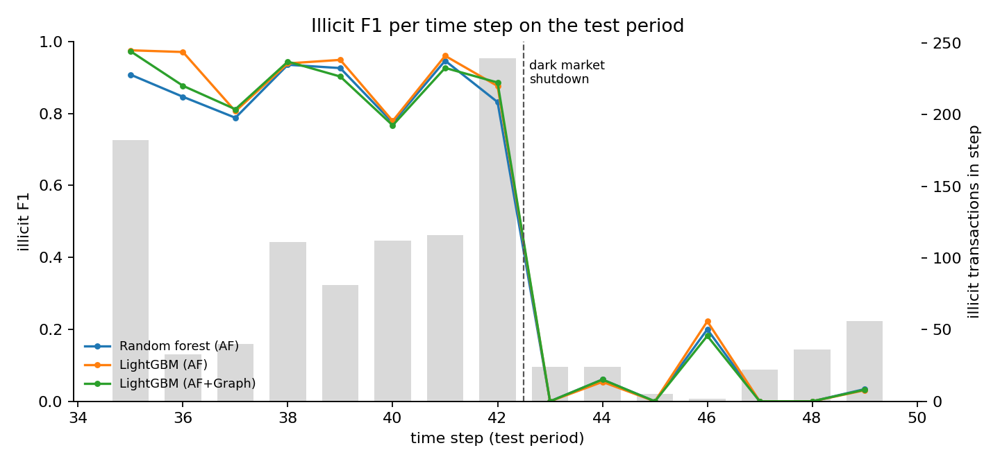
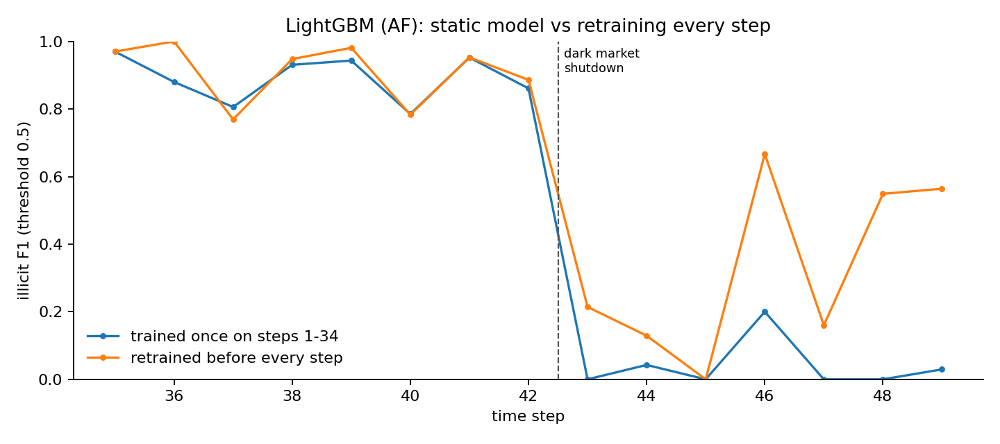
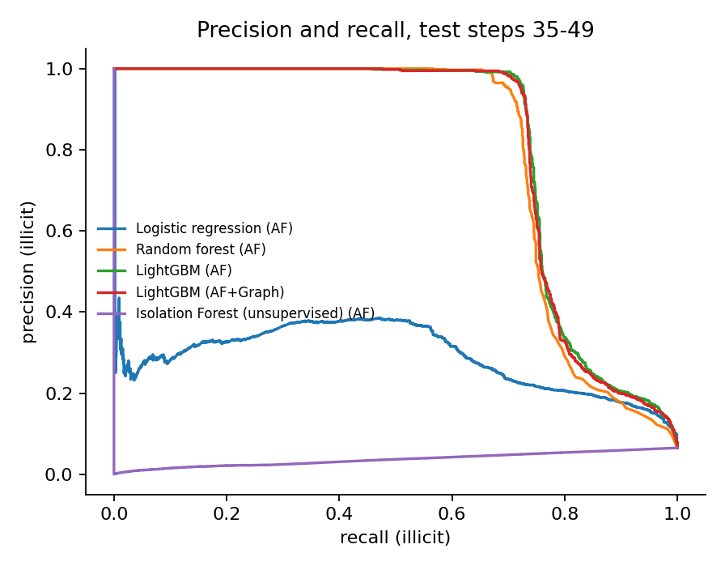

# Elliptic Fraud Detection

**Catching illicit Bitcoin transactions, and measuring what happens when the fraud changes.**


Detection models for the [Elliptic Bitcoin dataset](https://www.kaggle.com/datasets/ellipticco/elliptic-data-set)
(203,769 transactions, 234,355 payment flows, 49 time steps), evaluated the way a risk team would
deploy them: trained on the past, tested once on the future, scored on the illicit class, and
checked per time step for drift.

## Headline results

Test period: time steps 35 to 49 (16,670 labelled transactions, 1,083 illicit, base rate 6.5%).
Thresholds tuned on steps 30 to 34 only. Tree models: mean ± standard deviation over 3 seeds.

| Model | Features | Illicit precision | Illicit recall | Illicit F1 | PR AUC |
|---|---|---:|---:|---:|---:|
| **LightGBM** | AF + graph | **0.926 ± 0.008** | 0.727 ± 0.003 | **0.815 ± 0.003** | **0.807** |
| LightGBM | AF | 0.913 ± 0.019 | 0.732 ± 0.004 | 0.812 ± 0.005 | 0.807 |
| Random forest | AF | 0.902 ± 0.019 | 0.715 ± 0.009 | 0.798 ± 0.003 | 0.793 |
| LightGBM | LF | 0.878 ± 0.039 | 0.701 ± 0.012 | 0.779 ± 0.008 | 0.790 |
| Logistic regression | AF | 0.375 | 0.357 | 0.366 | 0.290 |
| Isolation Forest (no labels) | AF | 0.062 | 0.956 | 0.117 | 0.037 |

LF = 93 local transaction features. AF = LF plus Elliptic's 72 one hop aggregated features.
Graph = degree features plus local features propagated 1 and 2 hops over the transaction graph.

**Sanity check against the original paper.** At the default 0.5 threshold, the random forest on AF
scores precision 0.972, recall 0.676, F1 0.797, close to the 0.956 / 0.670 / 0.788 reported by
Weber et al. (2019) for the same model, features and split.

## What I found

**1. Gradient boosting is the strongest model, with very high precision.** LightGBM flags
transactions that are illicit about 93% of the time and catches about 73% of illicit
transactions in the test period. For a review team, that precision matters: almost every alert
is worth an analyst's time.

**2. My graph features did not meaningfully help, and that is a finding.** Adding degree and
propagated neighbourhood features moved LightGBM F1 from 0.812 to 0.815, which is within seed
noise, and PR AUC did not change. The propagated features took about 17% of the model's gain,
mostly from the local features they were built from (the local share fell from 80% to 67%), so
they re-expressed information the model already had rather than adding new signal.
Neighbourhood information does matter: going from local features only (LF) to AF adds about
0.03 F1, so Elliptic's own one hop aggregates already capture most of it.

**3. Illicit transactions are not outliers.** Isolation Forest, which never sees labels, scored a
PR AUC of 0.037, below the 0.065 you would get by ranking at random. Illicit activity in this
data looks statistically ordinary, so unsupervised anomaly detection alone would miss it;
labels are doing the work.

**4. Every model collapses after the dark market shutdown at step 43.**



| LightGBM (AF + graph) | Steps 35 to 42 | Steps 43 to 49 |
|---|---:|---:|
| Illicit F1 | 0.90 | 0.03 |
| Precision of the top 30 alerts per step | 0.99 | 0.04 |

Before step 43, nearly every one of the 30 highest scored transactions in a step is illicit.
After it, almost none are. The illicit behaviour that followed the shutdown looked different from
anything in the training data, which is exactly the "attackers adapt" problem a risk team faces.

**5. Retraining every step helps, but only partly.** Retraining LightGBM (AF features, threshold
0.5) before each test step on all earlier labels (`scripts/run_retraining.py`) catches 44 of the 169 illicit transactions in
steps 43 to 49, against 3 for the model trained once, and lifts mean per step PR AUC from 0.14
to 0.54. Detection recovers to about 0.55 F1 by steps 48 and 49 but stays far below
pre-shutdown levels, consistent with the original paper. This assumes labels arrive before the
next step, so it is an upper bound on what frequent retraining could achieve.



### What this would mean for a production risk system

* Track alert quality per period (for example precision of the top k alerts) as a live metric:
  here it falls from 0.99 to 0.04 in one step, long before a quarterly review would notice.
* Retrain on a short cadence and keep a fast label feedback loop from investigations.
* Shadow test retrained models against the live one before promoting them.
* Do not rely on unsupervised anomaly scores alone for this kind of fraud.

## Method

| Step | Choice | Why |
|---|---|---|
| Split | Train on steps 1 to 34, test once on 35 to 49 | Same protocol as Weber et al. (2019); no peeking at the future |
| Threshold | Fit on 1 to 29, pick the F1 maximising threshold on 30 to 34, refit on 1 to 34 | The test period is never used for tuning |
| Imbalance | Class weights, no resampling | The model sees the real distribution; the threshold is tuned explicitly |
| Graph features | `A_hat = D^-1/2 (A + I) D^-1/2` applied 1 and 2 times to the local features, plus degrees | GCN style neighbourhood smoothing (Simplified Graph Convolution) usable by any tabular model |
| Models | Logistic regression, random forest, LightGBM, Isolation Forest | Linear baseline, the paper's best model, a strong boosted model, and an anomaly detector |
| Metrics | Illicit precision, recall, F1, PR AUC; per step F1; precision of the top 30 alerts per step | Accuracy is meaningless at this imbalance; top k precision mirrors an analyst's review queue |

The time step is never a feature, labels are never propagated through the graph, and every edge
connects transactions in the same time step, so no test period information reaches training rows.
A detailed explanation of every decision is in [docs/WALKTHROUGH.md](docs/WALKTHROUGH.md).



## Reproduce

```bash
pip install -r requirements.txt
# download the dataset from Kaggle and unzip it into data/raw/ (see data/README.md)
python scripts/run_experiments.py --data-dir data/raw    # about 25 minutes on 2 CPU cores
python scripts/run_retraining.py --data-dir data/raw     # about 3 minutes
pytest -q
```

No dataset? `python scripts/run_experiments.py --synthetic` runs the full pipeline on a small
synthetic dataset in the same format in under a minute. CI runs this on every push.

## Repository structure

```
src/elliptic_fraud/
  data.py        loading and validation of the three Elliptic CSVs
  graph.py       adjacency, degree and propagated graph features
  split.py       temporal splits for tuning, training and testing
  models.py      model factories with class weighting
  evaluate.py    illicit class metrics, threshold tuning, per step and top k metrics
  synthetic.py   synthetic data in the Elliptic format for tests
scripts/
  run_experiments.py   all models and feature sets, writes results/ and figures/
  run_retraining.py    static model vs retraining before every step
results/         metrics.json, summary.csv, per_step.csv, retraining.csv, all_runs.csv
figures/         plots used in this README
tests/           pytest suite (runs on synthetic data)
docs/WALKTHROUGH.md
```

## Limitations

* Features are anonymised by Elliptic, so the model cannot be explained in business terms;
  importance only shows which anonymous features matter.
* Labels come from Elliptic's heuristics and are incomplete: 77% of transactions are unknown.
* The graph features are fixed propagation, not a learned graph neural network. The original
  paper's GCN scored 0.628 illicit F1; a learned GNN is future work.
* Retraining results assume immediate labels and are an upper bound.

## References

* Weber, M. et al. (2019). Anti-Money Laundering in Bitcoin: Experimenting with Graph
  Convolutional Networks for Financial Forensics. KDD Workshop on Anomaly Detection in Finance.
  [arXiv:1908.02591](https://arxiv.org/abs/1908.02591)
* Wu, F. et al. (2019). Simplifying Graph Convolutional Networks. ICML.

## Author

Brijesh Dangwal, Master of Computer Science (Data Science and AI), University of Sydney.
[GitHub](https://github.com/BrijeshDangwal)
